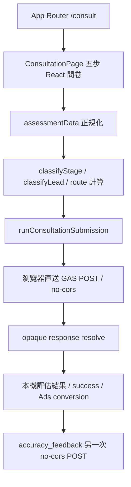
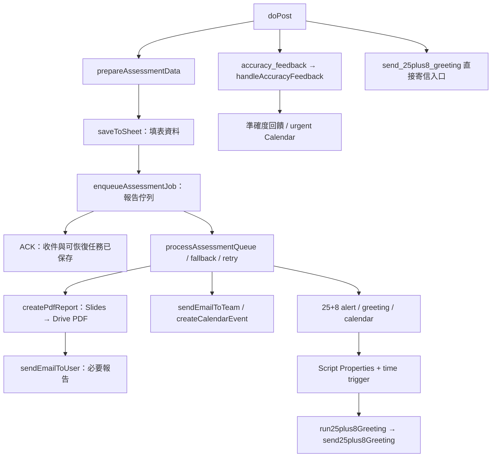

# 免費出發評估：現況盤點與 v1 資料契約（Issue #61）

盤點日期：2026-11-24。前端基準：`develop` 的 `d421d47fcf97d63b5b786c185fc4cda2dc58e9fb`。
本文件為 #62–#69 的共同開發規格，**尚有來源驗證阻擋，不能視為 #61 全部驗收完成或正式發布核准**。
原 PR #70 僅新增文件；#62 同步最新營運決策並清理指定舊網址。下文現況盤點仍以原基準為準，#62 實作狀態見第 12 節。

## 1. 證據與可信度

| 來源 | 本次核對結果 |
| --- | --- |
| [Issue #61](https://github.com/lilaiireland-tw/lilai-web-platform/issues/61) | 已完整讀取本文；目前無留言。最新九項決策及 2026-11-24 GAS 補充優先於舊敘述 |
| [#62](https://github.com/lilaiireland-tw/lilai-web-platform/issues/62)、[#63](https://github.com/lilaiireland-tw/lilai-web-platform/issues/63)、[#64](https://github.com/lilaiireland-tw/lilai-web-platform/issues/64)、[#65](https://github.com/lilaiireland-tw/lilai-web-platform/issues/65)、[#66](https://github.com/lilaiireland-tw/lilai-web-platform/issues/66)、[#67](https://github.com/lilaiireland-tw/lilai-web-platform/issues/67)、[#68](https://github.com/lilaiireland-tw/lilai-web-platform/issues/68)、[#69](https://github.com/lilaiireland-tw/lilai-web-platform/issues/69) | 已讀取各票本文與 GAS 補充；本文件不執行這些票 |
| repository 前端 | 直接讀取 React、評估、提交 helper、analytics、測試及 routing policy；下文「已核實」僅指這份原始碼 |
| GAS 原始專案 | workspace 未找到 `.gs`、manifest 或 clasp 專案。已請 Alex 補交原始碼／路徑。下文所有 GAS 函式、行號及行為來自 Issue 補充，**非直接原始碼審查，也非 live deployment 證據** |
| GAS 快照描述 | Issue 記載 3,830 行、2026-11-24、`ruleVersion=index2-sync-2026-09-14-r2-two-routes`、V57 PDF/E2E；不能據此認定正式部署一致 |
| [公開政策](https://lilaiireland.com/agreement/) | 即時唯讀 GET 回 HTTP 403；web fetch 亦未取得內容。無法核對最新文字、版本、生效日、手機可讀性；不能判定缺漏或宣稱完全合規 |
| 公開 `/consult/` 與舊網址 | 原盤點唯讀 GET 均 403，不能作為現行生產表單證據；營運已確認舊 `/free-departure-assessment/` 停用，不再要求核對／維護舊表單頁面才能完成盤點 |

不將正式 Google 資源 ID、部署識別碼、憑證或個資複製進本文件。端點以既有 `ConsultationPage.tsx` 的 `GAS_ENDPOINT` 定位；實際 Project/Deployment/Sheet/Template/Folder/Calendar 與 owner 對照表應放在限制存取的營運交接紀錄，repo 只記錄已驗證狀態及版本摘要。

## 2. 已核實的前端架構與資料流



- `src/app/consult/page.tsx`：`force-static` 頁面，使用 shared root shell，傳入 production analytics 開關；metadata 用 `absoluteUrl("/consult")`。本票不修改。
- `src/components/consult/ConsultationPage.tsx`：client component，`FormValues`、`initialValues`、`stepFields`、`fieldValid`、`validateFields` 管理五步問卷。姓名／暱稱／Email 必填，IG／LINE 選填；`lifeChange`、`webinar` 目前必填，兩個 consent 也被共同強制驗證。
- `assessmentData()`：trim 姓名／暱稱／Email／LINE／自由文字；IG 正規化為單一 `@` 前綴；`goals/barriers/resources/webinar` 以 `、` 串成字串，`wantWork` 由 `workIntention` 推導。
- `src/lib/consult/assessment.ts`：四種 Stage、Hot/Warm/Nurture、維度／路線／預算計算；問卷及新授權／調查資料必須分離，保留現有算法。前端 `lifeChange` 未參與此檔評分；GAS 另有既有加分規則，不能混為同一算法。
- `submit()`：送平面 JSON 至既有 GAS，`POST`、`mode: "no-cors"`、`Content-Type: text/plain;charset=utf-8`。payload 含評估結果、團隊信箱、資源、價格及 client 台北時間；**不含 consent1/consent2，亦無 submissionId、文案版本、來源調查或授權證據**。
- `src/lib/consult/submission.ts`：`runConsultationSubmission()` 的 per-mount gate 防同時提交／成功後重複；reject 可重試。任何 resolved request 都完成 gate，目前沒有 ACK 驗證；重新整理後亦無持久防重。
- `onResolved()`：顯示 client 計算的結果、`consult_submit_success` 與 Ads conversion。opaque resolve 只表示未發生 client network exception，不證明 Sheet／Queue 寫入。
- `submitAccuracy()`：先顯示感謝，再送 `type: accuracy_feedback`、姓名／暱稱／Email、stageName、leadQuality、accuracyAnswer、client submittedAt；「不太準」加 `urgentFollowUp: true`。沒有原提交 ID，失敗只 console log；畫面仍承諾當日聯繫。
- `src/lib/analytics/consult.ts` 與 `google-ads.ts`：沿用既有 consent／production guard／事件去重。Cookie analytics/advertising 授權獨立於聯繫／Email 行銷授權；不得互相推定。自訂 funnel 只有固定 form ID、event、step；新個資、來源自由文字、授權值、提交識別碼不送 GA4/Ads。

### 路由實況限制

`cloudflare/production-routing-policy.ts::productionRouteOwner()` 在程式政策中將 `/consult`、`/consult/` 給 platform；`/free-departure-assessment/`、`/agreement/` 落至 WordPress。`src/app/[...slug]/page.tsx` 有 WP fallback，但不等於舊入口在正式站存在或其中 JS 可運作。`docs/url-inventory.md` 的舊入口記錄是歷史證據；不得據此新增 redirect 或改 ownership。

唯一正式入口為 `/consult`，`/consult/` 保留現有 308 導向同頁。正式發布前由 Alex／部署維護者核對現行入口的 renderer、表單版本／端點及直接 GAS 的安全切換；舊網址不再是待遷移／維護入口。外部 WP 若仍可收件或列於 sitemap，交營運人工處理，不聲稱已刪除。403 尚未證實是站方或中介環境限制，不繞過或調整防護。

## 3. GAS／Google 資料流（Issue 快照摘要，待原始碼核實）



### 儲存及副作用清單

| 節點 | 摘要中的實際用途／風險 | 必須補核 |
| --- | --- | --- |
| `doPost`（83+） | 直接 JSON.parse；feedback／direct greeting 早於 prepare；正常 ACK 已是 `{status:'ok',accepted:true,jobId}` | 所有分支驗證、部署可見性、exec 身份、真正回應 |
| `prepareAssessmentData`（3516+） | spread 原輸入再整理字串、後端計算；未強制 nickname，client 可夾帶內部欄位風險 | allowlist、安全欄位、算法版本、空值 |
| `saveToSheet`（2854+）／「填表資料」 | 現有 header missing append／name mapping；跟進日期、Follow-up 建議及人工 outcome/discount 欄位 | 完整 header/schema、公式、時間欄、權限、row/job 對照 |
| `enqueueAssessmentJob`／「報告佇列」 | 八欄，含 Data JSON、PDF URL、錯誤／checkpoint；另產 UUID | 八欄精確名稱／索引，不能臆造 |
| `processAssessmentQueue`（含 792–843） | `QUEUED/PROCESSING/RETRY/COMPLETED/ERROR`；`_stepState`、`saveJobCheckpoint` | 實際 lock／checkpoint 邊界、人工重跑／匯出入口 |
| `fallbackAssessmentQueue`／排程 | 三次 attempts、10 分鐘 stale recovery、30 秒 wake、5 分鐘 trigger stale、2.5 分鐘／3 jobs batch；保留 | manifest/runtime 限制、trigger owner、失敗告警，不直接執行 |
| `createPdfReport` | Slides placeholder → Drive 匯出；個人 PDF `ANYONE_WITH_LINK / VIEW` | 模板 Page 10 固定 CTA、輸出資料、分享／暫存清理 |
| `sendEmailToUser`／`buildUserEmailHtml` | HTML／純文字，嘗試附 PDF，失敗可能用公開 link | 附件失敗路徑、MailApp 寄件身份、收件副本、服務與推廣混用 |
| `sendEmailToTeam`／Calendar | 必要收件通知與跟進指示混用；一般 Lead／Hot 同日兩種 Calendar | 預設 Calendar 實際 owner、ACL、提醒與描述中的個資 |
| 25+8 functions | alert、Calendar、問候信、Properties、time triggers | `greeting_trigger_`／`greeting_` 內容、舊排程、取消／重試入口 |
| 準確度回饋 | `handleAccuracyFeedback` 保存並可能產生今日聯繫 Calendar | 如何對應原紀錄、可否重複、權限檢查 |
| Cache／Lock／Properties | dedup 60 秒、IN_FLIGHT 20 秒；tryLock 失敗可能仍繼續，分開鎖 Sheet／Queue | 不能當持久冪等保證；含 PII 的 Properties 亦須保存管理 |
| CRM／EDM／人工匯出 | 摘要未見 Notion 同步或 EDM sender | Alex 盤點其他專案、外掛、手動名單、下載檔、備份／維護者 |

摘要中的 `generateAIAnalysis` 是規則／字典／加權計分，未見 `UrlFetchApp`、外部 LLM API、Notion 同步。**不新增 AI 整合，也不把「未見」寫成整個生產系統不存在第三方**。需待完整專案／部署比對後確認。

GAS 檔名、實際專案位置、manifest scopes/timezone、deployment version、trigger owner、各 Google 資源位置目前未知；Alex 提供受限位置及唯讀來源，實作者記錄快照 hash／版本與 deployment 差異。不能把已存在的前端 endpoint 證明為指定專案的當前版本。

## 4. 所有授權判斷入口與營運衝突

### 用途分流

| 本次 contact | Email marketing | 完整評估／PDF／必要服務信 | 本次非必要主動聯繫 | 後續 Email 行銷 |
| --- | --- | --- | --- | --- |
| false | false | 保留 | 禁止 | 禁止 |
| true | false | 保留 | 有效且未撤回才可 | 禁止 |
| false | true | 保留 | 禁止 | 有效且未退訂才可 |
| true | true | 保留 | 有效且未撤回才可 | 有效且未退訂才可 |
| legacy unknown | legacy unknown | 保留 | 無可追溯依據則禁止 | 禁止 |

使用者自行要求回覆／自行預約之必要服務另按已告知的服務依據處理；不得把填表、Hot、選說明會主題、回饋「不太準」或留 IG/LINE 當 opt-in。Email 行銷授權絕不延伸到 IG／LINE。

### GAS 必須涵蓋的 gate（函式名稱待原始碼逐一確認）

| 入口／函式 | 正式實作要求（#63／#66） |
| --- | --- |
| `prepareAssessmentData`、`getFollowUpDays`、`saveToSheet`、`getContactSuggestion` | 分數與授權獨立；未同意不產跟進日期、主動開場或指示。有效 contact 首次任務須符合 1–2 工作天，0/5/14 天僅可用於後續合法排序 |
| `processAssessmentQueue`、retry、stale recovery、`fallbackAssessmentQueue`、人工重跑 | 執行每項副作用前讀最新授權，不只看 Data JSON；必要 PDF／服務信不 gate；無授權的聯繫步驟記 skipped checkpoint，非 ERROR，不反覆重試 |
| `sendEmailToTeam` | 可保留最小必要內部收件通知；未授權明示「僅評估／不主動聯繫」，移除聯繫指令 |
| `createCalendarEvent`（一般及 Hot 同日）、`create25plus8CalendarEvent`、`sendTeam25plus8Alert` | 本次 contact 有效才建立聯繫／提醒；必要內部服務工作另明確分類 |
| `schedule25plus8Greeting` | 排程前檢查；保存可信 submissionId。實際下一次台灣 18:11（`getNext1811TaipeiMs`），不是註解的一小時，不改寄送時間 |
| `run25plus8Greeting`、`send25plus8Greeting` | 寄送當下、排程失敗 fallback 直接寄、10 分鐘 retry 最多三次及舊 property prefix 均查最新授權；撤回／unknown 抑制並記錄 skipped |
| `doPost type=send_25plus8_greeting` | 可信 server credential、原提交 lookup、最新有效用途授權；不能接受 client 指定收件者後直接寄 |
| `doPost type=accuracy_feedback`、`handleAccuracyFeedback` | 回饋可以保存；以可信原提交判斷 contact，不能相信 client urgentFollowUp／email／consent；未授權不建今日 Calendar |
| 任何 EDM、CRM sync、名單 view／匯出、人工聯繫 | 發送／匯出當下重新核對最新有效授權及 suppression；已匯出名單不能成為繞過途徑。尚未辨識的工具須由營運補盤點 |
| 撤回處理 | 即刻更新有效狀態；未執行工作取消／標 skipped，舊 Calendar／團隊指示停止聯繫，可先人工清單；不批次刪正式事件 |

25+8 問候信若僅履行本次明確要求的個別評估聯繫，需 contact；若另含促銷或未來活動行銷，亦需 marketing 及可用退訂，不能用「服務」名稱繞過。

### 已找到的前後端／營運衝突

1. 前端強制兩個舊 consent，卻未傳後端：與獨立選填、預設 false、不同意仍有完整服務衝突。舊勾選不構成可追溯證據，不回填 true。
2. `lifeChange/webinar` 現必填；新規格均選填。GAS `calcMotivationClarity`（1404+）對 lifeChange >20 字既有加一分，影響 Fit Check／readiness；空白可安全處理，但結果可因原規則不同，不能宣稱填空不改所有分數。不重新分配權重。
3. `STAGE_INFO.followUp` 無條件建議 nurturing／邀請／24–48 小時聯繫，`getAssessmentContent`、`getTimeAnchor` 與 `StageCta` 對 25+8 無條件承諾聯繫；成功回饋另承諾今日聯繫。必須依有效 contact 條件呈現，不能只改 checkbox。
4. `benefits`、earlyBird、FAQ、Stage CTA 無條件承諾說明會通知；改為使用者自行選擇下一步及自願訂閱。GAS HTML／純文字／Slides 固定 CTA 同步核對。
5. 前端仍有自主評估包／付費諮詢 CTA，與最新定案不一致。#66 統一為自行回信或 LINE 免費索取《歐洲漫遊錄》說明會重播、團隊手動開放，觀看後免費一對一諮詢；所有人仍取得完整報告。僅 contactConsent 有效者可主動跟進協助；未同意者仍可自行索取。不新增影片自動寄送／權限自動化或付費 CTA，實際連結與模板仍須核對。
6. GAS 0/5/14 日跟進與對外 1–2 工作天首次聯繫不一致；下一次 18:11 問候信亦不等於已完成真人首次聯繫。
7. Alex 已定案保留單一個人 PDF 的 `ANYONE_WITH_LINK / VIEW` 及 Email 附件／下載連結，不新增下載驗證或修改既有分享權限。持鏈可讀有轉傳風險；不公開資料夾／Slides 模板／報告清單，PDF 避免非必要聯絡資料、證件及敏感自由填答原文，連結只寄該次收件者。仍須核對實際權限／內容，納入 12 個月保存及權利處理。
8. #62／#64 早期本文提到 `success:true`，最新 GAS 補充要求沿用 `status/accepted/jobId`。**本契約採最新補充，沒有 success:true 必填條件**。

## 5. 新版提交契約 `free-assessment.v1`

本節定義目標契約，不表示目前已支援。沿用平面 assessment payload，避免重包一層破壞既有 GAS；#62／#64 共同實作 allowlist adapter。UI／API／GAS 共用同一份核准版本與選項定義，不在 tests、模板及 renderer 各自維護不同常數。

### 5.1 Browser → 同網域 API → GAS

Browser 傳 JSON；同網域 API 真實路徑留至 #64 核對 ownership 後核准，不能把範例路徑當已存在。現行 routing policy 未將一般 `/api/*` 給 platform；只有 Next Route Handler 檔案不足以保證公開路徑可達。

| 欄位 | v1 型別／規則 | 舊資料／安全界線 |
| --- | --- | --- |
| `contractVersion` | 固定字串 `free-assessment.v1` | 新增；無版本走獨立 legacy adapter，不推定同意 |
| `submissionId` | client 產生 UUID v4；同一內容重試保留同 ID | 並非授權憑證；legacy 另由後端產 ID，無法保證跨請求去重 |
| `name`, `nickname` | trim 後非空 string，各最多 100 字元 | 保留必填；legacy 缺 nickname 保留原服務相容，不捏造 |
| `email` | trim、有效 Email 格式、最多 254 字元 | 唯一行銷渠道；不以 client email 作為任意紀錄存取依據 |
| `instagram`, `lineId` | string，選填 `""`，各最多 100 字元 | IG 沿用單一 @ 正規化；不是行銷 opt-in |
| `location`, `awareness`, `timeline`, `plan`, `workIntention`, `englishGoal`, `cityPreference`, `budget` | 保留既有必填與 `consult-content.ts::options` 的精確選項值 | GAS／API 驗證 allowlist；不能拿舊公開頁的選項覆蓋現行問卷 |
| `goals`, `barriers`, `resources` | 沿用 `、` 分隔 string；解析後每項需為既有選項，非空、不重複，barriers 最多三個 | 單組最大值由其 allowlist 全選序列化長度限定，不接受任意長字串 |
| `lifeChange` | trim string，選填 `""`，最多 3000 字元 | 空白不杜撰；保留原有 >20 字評分，不讓新欄位參與 |
| `webinar` | 同既有 `、` 分隔選項，選填 `""` | 興趣不等於寄信同意 |
| `contactConsent`, `marketingConsent` | 兩個必帶 **boolean**，UI 各自初始 false；false 也要保存 | v1 缺值／null／`"false"`／0 均拒絕，不做 truthy coercion；legacy 缺值保存 null |
| `privacyNoticeVersion` | 必帶非空版本 key，後端已核准 registry allowlist | 不是 client 任填日期；實際 key 待公開政策快照驗證後登錄 |
| `consentTextVersion` | 必帶非空版本 key，後端已核准 registry allowlist | 對應第一步／第五步告知與兩項 checkbox 的實際文字快照 |
| `consentSource` | 固定 `free_assessment` | 後端驗證／保存，不代表 cookie consent |
| `discoveryChannels` | string[]，選填 `[]`，見下表 | 新版必帶空陣列；legacy 未蒐集為 null，不假裝作答 |
| `discoveryOther` | trim string，選填 `""`，最多 200 字元 | 僅 channels 含 other 可有文字；不含 other 但帶文字視為 validation error；UI 取消時清空 |
| `dcardExposure` | enum 或 null，見下表 | 未回答是 null，不推填、不解讀為 no |

字元上限按 JS string.length（UTF-16 code units）對齊現有 maxLength。保留既有其他欄位長度／選項總量即可限制整體 payload；#64 實作明確 request byte limit、timeout、rate limit，依實際合法最大 payload 驗證，不能靠不受限 JSON。

`wantWork`、`stage`、`routeResult`、`blockerDiagnosis`、`stageName`、`stageDescription`、`nextSteps`、`followUp`、`leadQuality` 由後端可信輸入重算；`teamEmail/resourceLink/discountPrice/originalPrice` 由後端可信設定提供；`submittedAt` 保留後端既有台北顯示值。新 Browser 不傳這些權威值；legacy 即使傳入也不能覆蓋後端。`_stepState`、attempts、jobId、寄件／模板／資料夾設定、consentTimestamp 及其他內部欄位不可從 client spread 進任務資料。v1 未知鍵拒絕；legacy adapter 僅挑已知問卷欄位並忽略舊衍生值。

同網域代理須保護來源／大小／速率／timeout；GAS 所有 type 分支須驗證 server-only credential 與可信原提交，不留下繞過入口。credential 只在後端，不進 bundle、URL、repo 或 log。ContentService redirect 僅允許核准 Google 目的地，不能把憑證任意轉送第三方；驗證最終 JSON。具體既有環境 binding、可信傳輸方式於 #64 在讀取實際 GAS 後實作，不增 Worker/D1。

### 5.2 來源選項（沿用 #65 已定案，不再重問）

Q1：「在填寫這次免費出發評估之前，你曾經透過哪些管道看過或認識『哩來愛爾蘭』？」多選、選填、無預選。

| code | 顯示選項 |
| --- | --- |
| `instagram` | Instagram（貼文／Reels／限時動態） |
| `threads` | Threads |
| `google_website` | Google 搜尋／哩來官方網站 |
| `dcard` | Dcard（心得分享／文章推薦） |
| `facebook` | Facebook（社團／貼文） |
| `accupass` | Accupass |
| `referral` | 朋友、學長姐或熟人推薦 |
| `youtube` | YouTube |
| `other` | 其他（勾選才顯示選填文字） |
| `unknown` | 不確定／沒有印象（與所有其他選項互斥） |

陣列不得重複；最多九個非 unknown 選項，unknown 單獨一個。wire `[]` 表示本次未答；`["unknown"]` 表示明確不確定；兩者分開統計。以表中固定順序正規化後持久化為 JSON array 字串，不以 `、` 串來源代碼。`other` 可配空白文字，不強制填寫。

Q2：「在填寫這次免費出發評估之前，你是否曾看過學長姐在 Dcard 分享『哩來愛爾蘭』相關的文章或心得？」單選、選填、無預選，無論 Q1 是否勾 Dcard 均顯示。

| code | 顯示選項 |
| --- | --- |
| `yes` | 有，我曾經看過 |
| `maybe_dcard` | 不太確定，但有印象在 Dcard 看過相關分享 |
| `maybe_other` | 不太確定，有印象看過相關分享，但不是在 Dcard |
| `no_recall` | 沒有／沒有印象 |
| null | 本次未答（不是選項按鈕） |

Q1/Q2 可出現不同組合，不自動推填、不強迫一致。來源與 consent 不進 scoring、PDF、個人化分析或 GA4/Ads。#68 以唯一 submissionId、時間窗、有效作答分母計多選占比與交叉表；合計可超過 100%，不宣稱首次來源或因果歸因。

### 5.3 同意證據、目前狀態與保存時間

- 每筆提交保存原 boolean／legacy null、版本、`consentSource`、submissionId、jobId，以及 **GAS 初次可靠接收時生成**的 UTC ISO 8601 `consentTimestamp`。表示當時選擇紀錄時間，false 仍有時間；重試不得改寫原 timestamp。legacy 不補造過去同意時間。
- 保存不可覆寫的事件／文案歷史，另有目前有效 marketing 狀態與本次 submission contact 狀態。最少可區分 granted／declined／unknown／withdrawn；`marketingUnsubscribedAt`、`contactWithdrawnAt` 用後端 UTC，撤回紀錄不刪除原始選擇。
- 以已核實的同一收件者授權關係套用 Email suppression；每次 send/export/sync 都查最新狀態。submissionId、email 或 jobId 本身不等於可操作權限；匿名填表勾 true 不能任意解除既有退訂。恢復須有可追溯、身份可信的明確重新訂閱流程，#63 落實；新未勾選不恢復。
- 退訂使用不含明文個資、不可猜測／簽章憑證；無登入要求、冪等、後端立即生效。一般 GET 不因郵件掃描器自動退訂，採明確確認／POST；按發送渠道需求支援 one-click。每封行銷 Email 必含可用退訂，尚無 sender 也先落實 suppression 與營運發送 gate，不造 EDM 平台。
- `receivedAt` 記後端首次接收時間，與 consentTimestamp 分開；未成交免費評估從該筆首次填表接收當日（既有 Asia/Taipei 日期基準）起算 12 個曆月。重試不改原日期，後續互動、行銷寄送、排程及 checkpoint 均不延長期限，不新增最後有效互動追蹤欄位。舊資料沿用可信填表時間，無日期列人工核對、不臆造。正式服務／法定義務／必要證據／最小 suppression 分類另立依據，不能一律永久保存；#62 不執行正式批次刪除。
- Sheet 新欄位以名稱 append，不改舊欄位順序、不移動公式、不覆蓋 `used_discount/discount_outcome/final_outcome`。false 用 `??` 而非 `||`；legacy unknown 在 Sheet 可空白，但有明確 legacy 版本／來源標記，adapter 讀回為 null；新版 dcard null 空白配 contractVersion，channels JSON `[]` 與 legacy 空白可區分。新增文字一律以純文字安全寫入，防公式注入。
- 此處是邏輯欄位契約；未知現有物理 header／權限狀態儲存位置不臆造。#62／#63 在原始碼與 Sheet schema 比對後，用既有 Sheets／Properties 機制完成最小可恢復儲存，不另設資料庫。

### 5.4 ACK、冪等與失敗

一般提交成功 envelope 沿用 GAS（下列為型別示意，不是實際回應紀錄）：

```ts
type AssessmentAck = {
  contractVersion: "free-assessment.v1";
  status: "ok";
  accepted: true;
  submissionId: string;
  jobId: string;
  receiptToken: string;
  jobStatus: "QUEUED" | "PROCESSING" | "RETRY" | "COMPLETED" | "ERROR";
};
type AssessmentError = {
  contractVersion: "free-assessment.v1";
  status: "error";
  accepted: false;
  submissionId: string | null;
  error: {
    code: "VALIDATION_ERROR" | "UNSUPPORTED_VERSION" | "UNAUTHORIZED"
      | "IDEMPOTENCY_CONFLICT" | "IN_FLIGHT" | "PERSISTENCE_FAILED"
      | "RATE_LIMITED" | "UPSTREAM_TIMEOUT" | "INVALID_ACK";
    retryable: boolean;
  };
};
```

- `status` 保留 envelope 用途，另用 `jobStatus` 明確表示既有 Queue 狀態，避免同一 status 同時代表 ok／QUEUED。與 #62/#64 一次落實，不雙軌要求 success。
- `receiptToken` 是 #64 後端簽發、綁定該 submission/job 與回饋用途的不可猜測或簽章憑證，非 GAS server credential。Browser 在後續回饋請求 body 提交，後端驗證；不因單憑可知的 ID／Email 就重新簽發。有效期／安全重取機制由 #64 配合實際 GAS 與既有平台能力定案並測試，不在本票實作。
- Browser 僅在 HTTP 2xx、有效 JSON、版本／submissionId 匹配、`status=ok`、`accepted===true`、非空 jobId、有效 jobStatus 同時成立時完成 UI gate／success／conversion。ERROR 表示先前已可靠接收、背景工作失敗，畫面需說明處理異常，不能假稱寄送成功或另建提交；其他成功狀態也只表示已接收，不代表 PDF／Email 已完成。
- ACK 必須在表單資料及可恢復 Queue 工作均持久化、ID 對照可讀後回傳。`IN_FLIGHT`、缺 jobId、HTML、200 error JSON 都不是成功；GAS 可能 HTTP 200，代理仍須讀 envelope。代理對 validation/version 回 400，未授權 401/403，ID 衝突 409，限流 429，上游無效回應／保存失敗 502/503，timeout 504；IN_FLIGHT 回可重試衝突狀態，不能標 accepted。
- 同 ID、同正規化 payload 取得原 jobId／現況，不重建 row／Queue／重排副作用；同 ID、不同問卷／consent／版本／來源回衝突。比對正規化後持久化資料，排除 server timestamps、credential 等易變值；不得用 Email+plan+timeline+budget 合併不同 ID 的新評估。
- timeout／未知收件狀態保留答案及原 ID，標待確認／可重試，不回報確定未送達。已確認接收後不容許同 ID 修改答案；修改內容需明確新提交，不能自動在未知狀態換 ID。
- #62 沿用 lock/checkpoint 作持久化對照與部分寫入修復：Sheet 已寫但 Queue 失敗須補完原工作，不能重插。Cache 過期不是去重失效理由。短鎖保護接收／對照，不把 PDF／Email 包在長鎖內。
- 外部寄信／Calendar 完成後 checkpoint 前中斷，既有機制不能保證 exactly-once；需可核實最小防重／人工 reconciliation，疑似已發送不得盲重寄。保留原 Queue 設定與 fallback，不重寫 worker。
- 錯誤只回 code／是否可重試，不反射 PII、堆疊、Google ID、credential；log 最小事件狀態，不記完整 body／自由文字／token。

### 5.5 準確度回饋與直接問候入口

回饋 v1 傳 `contractVersion`、`type:"accuracy_feedback"`、原 `submissionId`、`jobId`、`receiptToken`、`accuracyAnswer`（`很準/還好/不太準`），並以 #64 定義的 scoped receipt credential 證明可操作該提交。credential 不含 PII、不進 URL/log/analytics；具體發放與驗證須待實際 GAS 查核，未完成不得宣稱 ID 即有權限。

後端 lookup 原評估與最新 contact；不接受 client name/email/leadQuality/urgentFollowUp/consent 作為權威。回饋 ACK 沿用 `status:"ok",accepted:true`、匹配 ID、`feedbackStatus:"RECORDED"`，須已保存；不要求此 ACK 帶 Queue jobStatus。失敗保留回饋可重試，重複同一提交／相同答案不可重建通知；回饋不觸發主提交 conversion。

`send_25plus8_greeting` 為可信內部動作，不能作公開 Browser 任意寄信 API；同樣 credential／原資料／用途 gate／最新授權。上兩種 type 不可早於入口驗證而逃逸。

## 6. 政策核對與版本管理

唯一正式入口仍是 [WordPress `/agreement/`](https://lilaiireland.com/agreement/)。第一步簡短告知、第五步完整告知與政策連結；無強制閱讀 checkbox；正式語校申請另告知確認。姓名／暱稱／Email 必填、IG／LINE 選填，lifeChange 提醒不要填證件／健康等敏感資料。#65 已定案文案作為來源，不另編公司身份或重寫政策。

因本次 403，以下各項是**待核對清單，不是已確認的政策差異**；不能現在要求 Alex 補入可能已存在的段落。

| 公開政策核對項 | 實際技術依據／待完成事項 | 負責人 |
| --- | --- | --- |
| 蒐集者、權利窗口／聯絡方式 | 核對正式法律主體與聯絡人；前端 TEAM_EMAIL 或舊頁 footer 不能證明法定身份 | Alex／適格法律顧問 |
| 目的、資料類別、必要資料不提供的影響 | 免費報告必要服務與獨立 contact／Email marketing；姓名、暱稱、Email、計畫、自由文字、來源／授權紀錄 | Alex 核對文字，實作者對照欄位 |
| 保存期間、地區、對象、方式 | 首次填表接收當日起 12 個曆月及有依據的例外；Sheet／Queue／Properties／PDF／Calendar／Email／匯出備份的實際保存 | Alex 與 Google 資源 owner |
| 第三方／跨境及存取者 | Google Sheets、Apps Script、Slides／Drive、MailApp／團隊信箱、Calendar；確認實際帳戶／合約／處理地區與外包權限 | Alex／帳戶管理者／法律顧問 |
| 分類與自動處理 | 規則式階段、Lead Scoring／Fit Check／路線分析；目前未證實外部 LLM。若其他部署另有則補核 | GAS 維護者 |
| PDF 分享與服務 Email | 個人持鏈可讀、附件／fallback、收件副本；若現有說明與核准交付方案不同，只列最小補充 | Alex 與 GAS 維護者 |
| 查詢、更正、撤回、刪除及期限 | 真正窗口、身份確認、適用法律／時限與可操作人工 SOP；退訂直接有效 | Alex／法律顧問 |
| 版本、生效日期、可用性 | 取得當前公開 HTML／文字與日期、手機瀏覽證據、歷史版本 | Alex 提供可讀快照／WP revision |

核實後在受控版本紀錄保存政策／第一步／第五步／checkbox 的當時全文、核准人、生效時間、內容 hash、版本 key；公開可提交的政策文字才進 repo，不附 WP 私密匯出。submission 僅參照 immutable key，未核准的 key 拒絕。已過期但確實展示過的版本須明確相容窗口，不在頁面開啟期間靜默換成新版本。變更第三方、用途或文案時新增版本，不覆寫歷史，不把版本更新當重新取得同意。

## 7. 需要修改的前端檔案、測試與 GAS 位置

下列是後續票的修改定位，**本票不修改**；不要求把每檔都改一遍。

| 實際檔案／位置 | 函式／內容 | 票 |
| --- | --- | --- |
| `src/components/consult/ConsultationPage.tsx` | FormValues／initialValues／stepFields／fieldValid／assessmentData／submit／submitAccuracy／StageCta、earlyBird、結果／回饋、告知與 consent UI | #64–#66 |
| `src/components/consult/consult-content.ts` | options／題目映射、benefits、FAQ；重用單一新選項與版本來源 | #65/#66 |
| `src/components/consult/consultation.module.css` | 僅新增告知／來源／checkbox 所需 layout，沿用 design tokens | #65 |
| `src/lib/consult/submission.ts` | request 必須先驗證 ACK 才 resolved 完成 gate；保留 retry／答案 | #64 |
| `src/lib/consult/assessment.ts` | AssessmentData 邊界、STAGE_INFO.followUp／getAssessmentContent／getTimeAnchor；分類／route 算法不改 | #66 |
| `src/lib/analytics/consult.ts`、`src/lib/analytics/google-ads.ts` | 保留事件／Cookie guard／去重；主要改成功呼叫邊界，不預設需改這兩檔 | #64/#67 |
| 新同網域 Route Handler／shared contract 定義 | 路徑與檔名於 #64 路由審核後確定，現不存在；沿用 platform，不新 Worker | #62/#64 |
| `scripts/check-consult.ts` | 現有硬編 endpoint／兩次 no-cors、評估與提交 lifecycle assertions 改成新版必要驗證 | #64–#67 |
| `scripts/check-consult-analytics.ts`、`tests/consult-analytics/funnel.spec.ts` | ACK 成功邊界、事件不變／不含新資料、失敗不 conversion | #64/#67 |
| `tests/precutover/consult.spec.ts` | acceptConsents、必填、mocked-ok／GAS 直送 fixture 改 ACK／四組 opt-in／空值／調查互斥；不能把 mock 當真正 E2E | #65/#67 |
| `docs/consult-migration.md`、`docs/qa/consult-analytics.md` | 實作後更新目前明示的 no-cors 舊契約與 QA 說明 | #64/#67 |
| 原始 `.gs`／manifest／Slides 模板（位置未知） | 第 3、4 節全部函式，另 `FRONTEND_STAGE_INFO`、`getAssessmentContent`（3496+）、`getTimeAnchor`（1525+）、`getPdfNextSteps`（3686+）、`getRoutePlaceholders`、`getStageCTAText`、`calcMotivationClarity`／`calcIrelandFitCheck`／`adaptReadiness` | #62/#63/#66 |

`index-with-wp-note.md` 是歷史移植來源，不是新版主要 runtime 實作；不以改舊 HTML 代替 React 表單。`src/app/consult/page.tsx`、root shell、SEO／canonical、signup backend、CI/CD 不屬本次變更。#64 如需限定 API ownership 另做最小審核，不能在本票提前改 routing。

## 8. 舊資料相容、測試環境及切換

### 相容底線

1. 既有問卷欄／報告／人工欄保留，新增欄依名稱 append；Queue 八欄不搬移、不排序、不清除 active row。row-index checkpoint 不能因 migration／清理對錯行。
2. legacy 無版本／ID／授權欄仍可由可信相容 adapter 生成完整服務報告；缺授權為 null，有效權限 fail closed。歷史 consent1/2 未保存的事實不能透過「當時應已勾」補造成 true。
3. 既有 Queue／Properties 舊快照在執行時 lookup 最新權限，缺可追溯對照則抑制非必要聯繫／行銷，必要服務照常；skipped 不無限 retry。人工跟進日期不等於授權。
4. 舊無 submissionId 跨請求防重保證有限，必須明示；不可對新 v1 退化到 60 秒 Cache 或同 Email 合併。匿名舊直送不具新版可信入口安全，不得永久留成任意寫入例外。

### 隔離測試環境

由 Alex／GAS owner 提供獨立 Apps Script project／deployment、manifest、測試 Sheet（三個分頁）、Slides template／Drive folder、Calendar、Script Properties／triggers、測試寄件身份及受控測試收件者；憑證經私密渠道交付。staging proxy 只指向此測試部署，啟用前檢查全部 ID 與 production 不同，不能只換 TEAM_EMAIL。

現有測試入口（名稱來自 Issue）：`testRun`、`testPdfOnlyV57`、`testFullAssessmentE2E`、`inspectLatestAssessmentE2E`、`testQueueRetryAndIdempotency`。摘要指這些會用正式 Sheet／Drive／default Calendar／trigger，僅檢查團隊信箱不安全；先隔離或可信 stub，再做測試資源 E2E。**本次完全未執行 GAS 測試、寫 Sheet、建 Calendar 或寄信。**

#67 必測：四組 opt-in × stage／Hot-Warm-Nurture × 25+8；lifeChange/webinar 空白、兩來源未答／unknown／其他清空／跨題組合；Sheet 已寫 Queue 失敗、IN_FLIGHT、跨 60 秒重試／併發、不同 payload 同 ID、timeout、200 error／HTML；Email 已發 checkpoint 失敗 reconciliation；撤回後的 retry／fallback／direct greeting／舊 property／feedback／匯出；原 PDF 算法與 Slides 固定 CTA、HTML／純文字、附件失敗、分享取件；不將新資料傳 GA4。

Browser QA 留至 #65–#67：375/768/1024/1440px、overflow、鍵盤與 focus-visible、checkbox／radio 與錯誤宣告、返回保留、連結可讀、console／hydration、同 ID 重試／success 去重。實際 staging URL／deployment version 尚未提供；mock 不能替代真實測試資源驗收。

### 發布順序（計畫，非本票執行）

1. #61 已由 PR #70 合併；補齊尚未取得的原始碼、政策與資源清單證據，不重問已定案決策，不得將未核實項標完成。
2. #62 在隔離資源實作相容儲存、版本、持久 submission/job 對照、ACK；#63 完成所有用途 gate／退訂／舊排程抑制。兩者不能單獨正式啟用而仍讓舊自動化越權。
3. #64 完成既有平台同網域代理、可信 GAS 入口、可靠 ACK；#65/#66 更新 React／結果／PDF／Email／模板。使用同一核准契約，保留五步／算法／Queue。
4. #67 在隔離環境真正 E2E，核對公開政策／基本人工保存及權利 SOP、PDF 交付、舊入口相容、回復計畫與所有 release gate，Alex/Arsha 驗收。
5. 另行獲 Alex 發布核准後，先備份 schema／部署版本及最小回復資訊；協調部署 GAS 儲存與 gate、代理後端憑證與前端，不單獨放出新 UI。短暫相容窗口必須可控：舊公開 GAS 僅在核准切換期間保必要服務、所有非必要用途 fail closed；窗口截止、舊 WP embed 更新／處理與 rollback 資源由 owner 實際確認，不能在任意可寫入口仍開放時宣稱安全切換完成。
6. 關閉舊任意直接 type 寄送／寫入繞過後，確認正常新提交流程；監看最小錯誤／Queue 狀態。回復採已測試、仍保留授權 gate／suppression 的相容版本；不回到缺 gate 的舊 GAS，不刪新增欄／證據、不盲重放任務。前端必要時暫停收件並顯示真實狀態，不以 no-cors 假成功救援。

正式發布維持既有 main／部署流程，本文件不變更 CI/CD 或正式 Cloudflare Routes。#68/#69 進階自動化不是額外 release blocker，但基本歷史名單抑制、12 個月人工管理、權利窗口及可用退訂必須先可執行。

### 保存與刪除操作邊界

#69 覆蓋「填表資料」「報告佇列」Data JSON／PDF URL／checkpoint／錯誤、「準確度回饋」、兩種 greeting Properties／triggers、Drive PDF／暫存 Slides／trash、MailApp／團隊信箱、Calendar、CRM／匯出／備份。先 dry-run、列出數量／例外、人工審核與責任人；active Queue 不搬 row。停止過期／撤回聯繫任務，避免舊同步復活名單；無法刪除收件者已取得副本應如實記錄。正式批次刪除／變更公開 PDF 權限須另行授權。

## 9. #62–#69 的實作前提與 release gate

| Ticket | 前提／交付責任 | 正式發布條件 |
| --- | --- | --- |
| #62 GAS/Sheets | #61 完成合併；原始專案、schema、測試資源；實作者落實 typed v1／legacy／冪等／ACK | 與 #63 gate 一起驗證，不單獨切換 |
| #63 授權／退訂 | #62 合併；原始函式／所有 triggers／人工名單與 sender 清單 | 最新狀態查核、可用退訂、歷史 unknown 抑制及 skipped checkpoint |
| #64 同網域 API | #63 合併；#62 envelope、既有 router ownership、server-only credentials／receipt 設計 | Browser 真 ACK；GAS 所有 type 不能繞過，舊入口切換可恢復 |
| #65 五步 UI | #61–#64 合併；核准政策／版本／文案、穩定契約 | 四組 opt-in、空白來源與 lifeChange/webinar 真寫測試 Sheet |
| #66 結果與模板 | #61–#65 合併；實際 Slides、Email、PDF 方案、有效 CTA 確認 | stage／用途一致、完整服務、無無條件聯繫／未授權行銷 |
| #67 整合 gate | #61–#66 合併；隔離且可追溯測試部署、Alex/Arsha 驗收 | 告知／依據／退訂／授權／ACK／PDF 取件／基本保存與權利 SOP／回復方案均就緒；另案部署核准 |
| #68 來源／View | #67 完成；#62/#63/#65 契約與有效權限已落實 | P1 不擴大 release gate；既有 Sheet 優先，不新增 CRM 平台 |
| #69 保存／權利自動化 | #67 完成；#61 核實實際保存／法律時限、#63 撤回機制 | P1 自動化可後做；基本人工義務不能延後；正式刪除另核准 |

## 10. 未解技術項目、責任人與真正需要決定的事

### 缺證據／存取（不是重問已定案營運選項）

| 項目 | 所需交付／負責人 | 影響 |
| --- | --- | --- |
| GAS 原始碼及 live 對照 | Alex 提供 3,830 行 `.gs`／完整專案受限路徑；GAS owner 提供 manifest、project/deployment 版本、trigger owner、各資源對照與 schema（不貼公開 repo） | #61 無法完成實際函式／位置驗收；#62/#63 不能以摘要或 mock 開始正式整合 |
| 政策最新公開文字／可用性 | Alex 提供當前 WP 文字／版本／生效日及唯讀可達來源，補桌面／手機核對；法律顧問核實身份、依據、跨境、權利時限 | 本次不能判定實際差異；核對後僅提必要文字補充交 Alex 更新 WP |
| 現行表單入口／舊直接 GAS | 部署維護者／Alex 確認 `/consult` 與 GAS deployment，列直接入口相容／安全切換窗口；舊網址停用不再列盤點 blocker | #64/#67 防繞過與相容方案；外部 WP 殘留交營運 |
| 測試專案與 Google 資源 | GAS owner 建立／提供隔離測試資源及授權；實作者驗證非 production | 未提供，沒有真正 E2E 結果 |
| CRM／EDM／人工匯出／保存實況 | Alex 列現有工具、存取者與操作人；GAS owner 核對其他腳本、時間／保存欄 | 未見不等於不存在；基本抑制與 12 個月 SOP 需可執行 |

### 已定案的補充決策（不再待決策）

1. **PDF**：維持單一 PDF 持鏈可讀、Email 附件及該報告下載連結，遵守第 4 節的內容／分享邊界；不新增私密下載方案。
2. **工作天**：週一至週五，沿用 GAS `Asia/Taipei`，首次聯繫僅向同意者承諾 1–2 工作天；不開發國定假日系統，既有 25+8 18:11 排程保留。
3. **保存**：後端首次填表接收當日起 12 個曆月，不因互動／重試延長，不新增最後互動追蹤。例外依據、人工執行人與舊資料可信日期仍須核實。
4. **CTA**：完整報告照常提供，自行回信／LINE 免費索取重播、團隊手動開放，觀看後免費諮詢。僅同意 contact 才主動協助；實際連結／模板核對不等於重新決定營運方案。
5. **入口**：`/consult` 唯一正式入口，`/consult/` 維持 308。舊網址已停用；#62 清理導流／索引，不遷移舊頁、不新增 redirect。

兩項 opt-in、Email 唯一行銷渠道、姓名／暱稱／Email 必填、lifeChange 選填、無政策確認 checkbox、歷史無證據禁止行銷、撤回／退訂、12 個月及政策唯一入口均已定案，不列回待決策。

## 11. 原 PR #70 驗證範圍（歷史紀錄）

- 工作區起始乾淨；fetch origin/develop 後將本地 develop fast-forward 至上述基準，再建立指定分支。
- 已閱讀 #61–#69、實際前端／helper／options／analytics／測試與路由政策；已嘗試唯讀公開 GET，結果與限制如第 1 節。
- 本次驗證只針對文件 diff／本機相對連結／衝突標記／敏感內容；不改 runtime，不以現有測試通過代表新契約實作完成。
- 未執行 npm ci／TypeScript／build／UI browser regression：本 PR 只有 Markdown，沒有前端變更。既有 `npm run lint` 使用 Next 16 已移除的 `next lint`，不在本票修復。
- 未操作正式 GAS／Sheets／Calendar／Drive／Email；未宣稱取得 live 原始碼或完成端到端驗收。待第 10 節補證後再完成 #61，PR 使用 `Part of #61`。

## 12. Issue #62 本次交付狀態（2026-11-24）

基準為已合併 PR #70 的 `develop`（`8e559c738556595ebe81be63b001781df2781ebd`）。本次完整讀取最新 #61/#62（均無留言），並搜尋 repository（含隱藏檔，排除 .git／node_modules）；未找到 `.gs`、`appsscript.json` 或 clasp 專案。Issue 的函式摘要不是實際原始碼，不能據此重建後端或宣稱完成 #62。

### 已修改

- `src/content/home.html`：三處評估 CTA 的原始 href 改 `/consult`，保留樣式、data attributes 及 HomeInteractions。
- `src/data/urlMap.ts`：IMPORTANT_URLS／STATIC_SITEMAP_URLS 移除停用入口。
- `src/app/sitemap.ts`：WP posts／pages 合併時過濾舊 slug，保留其他條目及 `/consult`。
- `docs/url-inventory.md`：保留歷史，標註停用及現行入口；本文件同步最新 PDF／工作天／保存／重播決策。
- `scripts/check-seo-url-consistency.ts`：沿用既有測試，驗證三處原始 CTA、靜態名單與含舊 slug 的 WP posts／pages 合併結果，以及其他 WP 條目保留。此 WP fixture 僅驗證 sitemap，不是 GAS mock 或後端驗收。

### GAS 未完成項目與交接

**實際修改的 GAS 函式：無。新增 Sheets 欄位：無。測試部署／腳本版本：未建立、未部署。** 第 5 節仍是目標契約，不是已實作的欄位、Payload 或 ACK 實例；本次沒有真實測試回應可交付，也沒有修改後 GAS 腳本可安裝。

因缺少原始碼，尚未實作或驗證型別／版本／來源 allowlist、兩項獨立 opt-in 與歷史文案證據、來源調查儲存、submissionId/jobId 持久對照、併發／重試／部分寫入恢復及假成功修正。既有 Queue／Checkpoint／Retry／Fallback／PDF／算法未修改。待來源齊備後，依第 5 節以短鎖保護持久對照、修復原 row／job，不將 Cache 當持久去重；這是後續要求，尚非已具備行為。寄出後 checkpoint 失敗仍須核實／人工 reconciliation，不宣稱 exactly-once。

Alex／GAS owner 後續提供：

1. 2026-11-24 的 3,830 行 `.gs`／完整專案與 `appsscript.json` 的受限路徑，快照版本／hash 與 live deployment 差異。
2. 「填表資料」「報告佇列」「準確度回饋」實際 header／公式結構（不含客戶資料），及隔離測試專案、資源、執行身份／trigger owner 對照。
3. 已核准政策／同意文案的歷史快照與 immutable version key，經受限方式提供必要資源設定及權限。

取得後才修改原腳本、交付版本差異與精確安裝步驟；先在隔離副本按名稱 append 欄位、不移動八欄 Queue／既有公式／人工欄，再以受控測試資料執行四組 opt-in、legacy、空值、同 ID 衝突、併發、跨 Cache 到期、部分寫入及重試。不得直接套用到正式資源；正式切換仍依 #63/#64/#67 的 release gate。本次 PR 使用 `Part of #62`，不關閉 Issue 或開始下一票。

### 待人工驗證

本次本機檢查結果：`npm.cmd ci`（632 packages）、`npx.cmd tsc --noEmit --incremental false`、`npx.cmd tsx scripts/check-shared-layout.ts`、`npx.cmd tsx scripts/check-design-system.ts`、`npm.cmd run check:seo-url-consistency`、`npm.cmd run build`（16/16 static pages）及 `git diff --check` 均通過。PowerShell 禁止 npm.ps1，改用等價 `.cmd`；Shared Layout 首次與 SEO 測試共用 Next dev 目錄發生鎖衝突，依序重跑通過。未執行已知無效的 `next lint`，未新增 CI gate；本機 HTTP 檢查不代表瀏覽器視覺 QA 或 GAS 整合驗收。

- 瀏覽器桌面／手機（375/768/1024/1440px）：三處首頁 CTA、hydration 前後導向、鍵盤／focus-visible、overflow、console／hydration errors。
- `/consult/` 的既有 308、canonical 與 query 保留由本機既有 SEO 測試涵蓋；正式環境未驗證。
- 外部 WP 舊頁是否仍可收件、WP 供應的公開 sitemap 是否仍列舊網址，由營運人工檢查；本次未修改 WordPress／Cloudflare／redirect。
