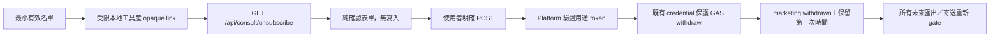

# Issue #63：退訂、有效名單與授權操作

基準：最新遠端 develop `f68b8639685bff8cf976907df609bf3c7bf316f7`，PR #75 已於 2026-11-24 合併。已閱讀最新 #61/#62/#63/#67/#68/#69 本文與留言，以及 #61/#62/#64/#66 文件。這是待審核的本地實作；未操作正式 Google 資源、客戶資料／郵件，未部署，尚不可開始行銷寄送。

## 現有管道盤點

| 證據 | 確認能力 | 限制 |
| --- | --- | --- |
| `scripts/gas/assessment-compat.js` 與本地 PR75 完整快照 | 「填表資料」保存原證據、當前 contact/marketing state 與第一次撤回時間；assessmentConsent 與受 credential 保護的 withdraw 入口 | 原本無可操作名單匯出／公用退訂／可信重新訂閱 |
| GAS `sendEmailToUser`、`sendEmailToTeam` | MailApp 必要報告與內部服務信 | 不是 EDM sender，不在其中插入行銷 |
| 25+8 alert/greeting/calendar、一般／Hot Calendar | contact gate 下的本次評估個別聯繫 | 不授權未來 Email 行銷；撤回後實際副作用前再查 |
| repository、文件、GAS 全文搜尋 MailApp／UrlFetchApp／CRM／EDM／unsubscribe／suppression／匯出，以及常見 sender 名稱 | 未發現行銷 sender、群發平台、Notion CRM 同步或既有行銷匯出實作 | 不能由單檔快照證明其他外部系統不存在；Alex 在 #67 補核外部外掛、人工名單與額外 suppression |
| signup CRM 型別／既有報名服務 | 是獨立正式申請資料流程 | 未改動，不把其欄位當免費評估行銷授權 |

沒有已識別 sender，因此不安裝 EDM、不建立群發、不寄測試行銷信。最小方式為既有 GAS 上的純名單函式及本地退訂連結組裝工具；不開放公用名單查詢 API。

## 本地 GAS 完整性與差異

保留原 `backups/issue62-gas/GAS.original.gs.txt` 與 `GAS.modified.gs.txt`，未覆寫。PR75 最終副本 SHA-256：`04aeef14fab2af70d521233a3c60b4c4b02d5243cc6cf47e39f8dddfb502a343`；最初原始 SHA-256：`b206bc35d5fb450128c0a89efd5aed20027a24c60759a066ff1d9ef2eba25d61`。

新完整副本與逐行差異僅留本機 `backups/issue63-gas/GAS.issue63.gs.txt`、`GAS.issue63.private.diff`。新副本 hash：`269cb61cee7109e7a318869d0885e30432588c3d55f54b57f6bc718fa57e8498`。完整 GAS、private diff、真實設定／ID 均不得 commit 或貼入 GitHub。

公開 diff 僅為 `scripts/gas/assessment-compat.js` 的完整授權 helper 修改，與私人 diff 同一邏輯。新副本在 `// Non-secret support functions appended` 之前的核心程式區段與 PR75 **逐字相同**，測試會斷言。只改 `assessmentConsent` 的 marketing 分支與 `withdrawAssessmentConsent` 的重新訂閱後退訂處理；contact 邏輯不變。新增時間驗證、marketing gate／最小匯出與受控證據 helper。未修改 doPost、Queue、Retry、Fallback、Checkpoint、Lock、TTL、PDF／算法、18:11 或資源設定。

## Email 行銷資格與歷史保護

`assessmentConsent(data, 'marketing')` 統一進入新 `assessmentMarketingConsent`，任何讀取／schema 錯誤由既有外層 catch 安全回 false。資格必須同時具備：

- data 及唯一匹配原始列的 boolean `marketingConsent === true`，contract 為 `free-assessment.v1`。
- 正規化 Email（trim＋lowercase）一致且格式有效，不以姓名、LINE、IG、Lead Score、contact 或 Calendar 推定同意。
- 原列 state 是 `granted`，本列沒有 `marketingUnsubscribedAt`。
- 嚴格有效、不晚於目前時間的 UTC ISO consentTimestamp，與 GAS 首次 receivedAt 一致；不接受 client timestamp／空值／無法解析時間。
- source 是 `free_assessment`，privacy／text 分別是 `agreement-reference.v1`／`free-assessment-consent.v1`，既有 `CONSULT_APPROVED_POLICY_VERSION` 必須核准該版本。
- 正規化 Email 任一歷史 withdrawn／退訂時間優先；缺可信時間也保持 suppression。只有下述可信人工重新訂閱可對新列解除舊 suppression。
- 既有行銷授權紀錄若有較新的撤回、無法讀取或 schema 損壞，排除。已知外部 suppression 未完成核對前禁止發送；不把未盤點視為無其他限制。

false／字串 true／legacy unknown／未核准版本／缺證據／不確定狀態皆排除。匿名重填即使 true 仍受歷史退訂抑制。contact 與 marketing 各自獨立；accuracy feedback 不改任何同意。必要 PDF、報告 Email、內部收件及使用者自行提出的服務照原流程。

## 最小名單與退訂連結操作

以下只是給受授權操作者在**隔離副本**驗收的流程，不授權操作正式表、寄送或部署：

1. 在隔離 GAS 呼叫 `exportAssessmentMarketingList()`。它逐筆重查最新 gate，依正規化 Email 去重，僅回傳 `[{email,submissionId}]`；不匯出姓名、問卷、IG/LINE、評分、來源調查或同意全文。不要用 Logger 印完整名單；透過受限內部操作保存該回傳值為 UTF-8 JSON，置於 ignored 的本地 backups 目錄。
2. 由秘密管理機制在操作者 process 環境提供 `CONSULT_UNSUBSCRIBE_SECRET`，執行 `npx tsx scripts/create-unsubscribe-links.ts <私有input.json> <新的私有output.csv>`。輸出僅 `email,unsubscribeUrl`，預設連結是正式公開主機；**本票不開啟／寄出連結**。#67 測試時只將主機替換成已核准隔離主機，path/token 保持。工具不讀 Sheet、不呼叫網路、不寄信、拒絕問卷 dump／重複 Email／公式型欄位／覆寫既有輸出。
3. GAS 匯出才是當下資格查詢；離線 CSV 是短暫組裝結果，不是持續授權。出現退訂、撤回、政策變更或時間間隔後丟棄舊檔，重跑 GAS 匯出。每次實際發送前必須再次用原 submissionId＋可信 Email／原列資料查 `assessmentConsent(...,'marketing')`；不得將任意 CSV 直接送至群發工具。未來 sender 必須能在寄送點套用最新 gate／suppression，否則不得啟用。
4. 禁止用原始整張表下載取代篩選，也不將授權名單傳至 GA4／Ads。輸出檔與 bearer 連結採受限存取及短期保存，#69 定義刪除；不要 commit、貼工單、公開 logs 或 email 大量附件。

逐筆重查會多次全表掃描；這是低量人工操作，不是大量匯出服務。未加索引、Cache 或新資料庫；實際數量、Google quota／秒數在 #67 驗證，無法在可用時間完成即停止匯出，不降級為舊名單。

## 退訂資料流與安全



- token 使用 Web Crypto AES-256-GCM、每次 96-bit 隨機 IV、128-bit authentication tag；additional authenticated data 固定 `consult.marketing-unsubscribe.v1`，只有這個用途可解密。plaintext 僅 submissionId，加密後 base64url；無 Email／姓名／問卷，client 也看不到 submissionId。單獨 ID 不具操作權。
- `CONSULT_UNSUBSCRIBE_SECRET` 必須是獨立隨機 32 bytes 的 64 位 hex server-only secret，與 GAS credential／feedback HMAC 分離；不放 NEXT_PUBLIC、公開 vars、repo 或 log。平台 runtime 與離線工具使用同一隔離 key；不用把此 key 交 GAS。未設定／格式錯誤回 503。
- token 無重新訂閱、contact、feedback 能力；公用 route 固定只轉送 `type=withdraw_assessment_consent,purpose=marketing`，不接 caller 指定 Email／purpose／credential。
- GET 只驗 token 並顯示原生可鍵盤操作的確認表單，不讀寫 GAS。POST 要同 origin、urlencoded、明確 confirm、固定欄位、實際 streamed body ≤512 bytes；共用原代理的 bounded transport／15 秒 abort／固定 GAS endpoint／單次安全 ContentService GET redirect。未確認 ACK 不宣稱完成，保留人工重試與回覆原信入口。
- HTML 確認直接由精確 API route 回傳，不建立新品牌頁／複製 Header/Footer，沒有 JavaScript、自動 submit、追蹤、第三方圖片或資源。回應 no-store、noindex/nofollow、no-referrer、CSP 禁外部資源及 framing，避免 token 載入外站或進 analytics。反射的 token 先經固定 base64url／認證驗證。
- 重複 POST 不改原證據及第一次退訂時間；已重新訂閱者再點舊信連結仍可退訂。只有 latest grant 時追加一次新的 withdrawal event，後續重複不再追加。
- bearer link 轉傳者可退訂該 Email 的行銷，但不能取得個資／授權；這是無登入退訂能力的限制。token 不自動到期，避免舊信失去退訂能力；ID 對應資料刪除後須依 #69 最小 suppression／人工處置。不要任意輪替 key 使舊信失效，輪替／疑似外洩需另行設計舊信相容及人工退訂方案。
- 只透過既有 `isConsultApiPath` 增 `/api/consult/unsubscribe` 精確 ownership；既有 Router／staging 共用此判斷，未改 Worker 數量／bindings／其他 API、WP、WooCommerce 或 canonical。

目前未識別 sender，沒有實際 List-Unsubscribe header 可整合，因此不實作 one-click endpoint，也不把一般確認 POST 冒充 one-click。未來實際渠道若要求 List-Unsubscribe／one-click，須在採用該 sender 前核對其協定、header 簽署、專用 POST 與 scanner 行為；本票連結不能宣稱符合該 sender 的發送要求。

## 人工撤回主動聯繫 SOP

1. 團隊收到 Email／LINE「不要再主動聯繫」時，先停止該人的人工跟進。依受限原紀錄確認對應信箱及 submissionId；Email／ID 本身不作身份證明。無法確定時先抑制聯繫，交由負責人透過已知管道核實，不索取不必要證件。
2. 授權操作者在既有受限 GAS 呼叫 `withdrawAssessmentConsent('<可信 submissionId>','contact')`（或受保護的內部 POST）。公用 marketing token 無此能力。查不到／多筆 ID／寫入失敗必須人工處理，不假稱完成，不手改原 contactConsent／版本／時間。
3. 確認 `contactConsentState=withdrawn` 及非空 `contactWithdrawnAt`，保留第一次時間。以 `assessmentConsent(可信原資料,'contact') === false` 核查；相同 Email 後續匿名重填也受抑制。**不修改 marketing**；若客戶明確也要求行銷退訂，另外呼叫 purpose=marketing 並各自核查。
4. 既有一般／Hot／25+8 Calendar 建立、alert/greeting、feedback 跟進及延後 Properties 任務在各自實際副作用前重查；撤回後尚未執行者安全略過，沿用原 checkpoint／retry/fallback，不改 Queue 或排程。必要報告與客戶自行提出的服務仍處理。
5. 已建立 Calendar／內部人工待辦不會自動撤回。維護受限人工清單：requestRef、可信 submissionId、事件私有連結／日期、負責人、停止聯繫確認時間。逐筆核對是否屬一般／Hot／25+8，通知執行者停止，依權限人工取消或標註；不批次刪除正式事件，不在 repo 保存事件連結／客戶名單。
6. 用原請求管道告知處理結果；處理回覆是服務訊息，不另寄行銷要求重新同意。記錄最小 requestRef／操作者／處理時間與結果，#69 管理期限。

## 可信重新訂閱 SOP（受控人工，沒有自動身份系統）

匿名重填與新的 true 不能解除 suppression。只有受授權操作者可執行此流程；沒有 public grant API，也不新增寄驗證信服務：

1. 使用者自行從該信箱聯繫團隊表示重新訂閱。若只是 LINE 要求、Email 文字／ID、轉傳截圖、未知代寄，不能核實信箱控制權，維持 suppression。不要向歷史 unknown 名單主動寄信要求同意。
2. 請申請人自行重新填評估表取得新的 v1 原證據（行銷明確勾 true；必要報告仍照常），**這一步仍不恢復訂閱**。核實新列在最後退訂之後，不能重用舊列／舊授權。
3. 操作者透過團隊原有信箱對該筆主動服務請求回覆一次隨機挑戰碼及當前核准政策／Email 行銷文案，要求從同一信箱回信確認挑戰碼及「同意重新訂閱 Email 行銷與說明會通知，可隨時退訂」。核對真正 From／Reply-To、平台驗證資訊及對話關聯，不能只看顯示名稱；無法可信核實、政策未核准或有其他 suppression，停止並維持 suppression。這是使用者提出的服務驗證，不是向舊名單發行銷。私下保存核實結果、challenge hash、文案／版本、回覆時間及操作者，以唯一 evidenceRef 連結，勿把原郵件全文／challenge／個資放 repo。
4. 另一位受授權人員核對上述證據後，在受限 GAS 呼叫 `recordVerifiedMarketingResubscription('<新 submissionId>','<唯一 evidenceRef>','<operatorRef>')`。後兩個欄位僅接受 3–100 位英數／底線／連字號參照。此函式信任操作者已完成信箱核實；**不是自動驗證 From 或僅填 evidenceRef 即證明身份**。限制 Apps Script 編輯與 Sheet 寫入權限，不給一般 client 或外部自動同步呼叫。人工核實期間暫停該 Email 的匯出／發送，若又收到撤回即終止重新訂閱流程。
5. 函式核對新原證據、政策核准、新列晚於所有已知退訂、reference 未使用及 ledger 完整，僅追加「行銷授權紀錄」tab 的 grant：正規化 email、submissionId、action、後端 recordedAt、evidenceRef、operator。沒有刪改原始勾選、第一次退訂時間或舊歷史。再次 `assessmentConsent(新原資料,'marketing')` 為 true 才能納入下次匯出；失敗不可手改 state 強行放行。
6. 新 grant 只對該新 submission 有效，其他匿名列不繼承。之後任何歷史連結退訂時追加 withdrawal 事件（重複冪等），全 Email 再受抑制；重新填另一份表也無法自動解除。不恢復 contact，人工 contact 撤回繼續有效。

這個 ledger 是既有 Spreadsheet 內的最小授權證據 tab，不是 CRM／新資料庫。人員或具編輯權者能偽造證據是既有信任邊界；缺可信操作者／信箱核實時維持 suppression。Google 操作非交易性，讀 gate 與副作用間仍有競態；沒有變更原 Lock，不聲稱並發或跨系統原子保證。

## #67 真實整合驗收清單（本票未執行）

- Alex 比對完整專案／manifest／deployment 與兩份 hash；私人 diff 審核，只套隔離副本。所有正式資源 ID／預設 Calendar／收件者換成隔離資源後，才由 #67 執行驗收。
- 核對公開政策、版本／生效日與核准文案；未核准時兩用途 fail closed、完整報告仍提供。
- 四組 opt-in × Hot/Warm/Nurture × 一般／25+8，實際 Queue 完成、PDF 與必要 Email；撤回前後一般／Hot／25+8 Calendar、alert/greeting、原 Properties／retry/fallback、feedback，不產生未授權跟進。
- 隔離 Sheet 實際欄位／公式／日期、同 Email 去重、unknown／false 排除；成功退訂後重新匯出為空，舊匯出不可寄；contact 撤回與 marketing 互不影響。
- 真正收件匣的測試退訂連結：掃描／preview／GET 不寫入；明確 POST 成功、重複不改第一次時間、失敗不假成功。當前沒有 sender，不執行行銷寄送；如日後確認現有 sender，再核對其 List-Unsubscribe／one-click 要求。
- 完整人工信箱控制權流程，無回覆／錯誤 challenge／錯誤信箱／舊 reference 不恢復；可信新回覆才追加 grant；之後舊連結仍可再次退訂，歷史不變。測試 ledger write 失敗與權限，維持 fail closed。
- Router／Platform runtime secrets／精確 path 實際可達、ContentService redirect；停用所有無保護舊入口。確認 observability／代理不記錄 token query/body／credentials／PII，確認頁不載 GA4／Ads 或外部資源。
- 瀏覽器 375/768/1024/1440px：確認／成功／錯誤頁的 overflow、原生 focus-visible、鍵盤／螢幕閱讀器、Safari／Firefox／LINE browser、console／hydration；既有表單、GA4／Google Ads、URL 不回歸。沒有 JavaScript 仍可確認。
- 實際新授權查詢、匯出規模／quota、Google 秒數與 15 秒 ACK，由 #67 量測。stub 計數不是實際效能證據；不在此票自行開始整合、部署或正式寄送。

## #68／#69 交接

#68 只沿用有效 gate 建 Sheet View／統計，不以 Lead／來源／contact 恢復授權，不把來源或授權個資送 GA4。若接既有 sender，確認每次發送最新 suppression，未完成不得使用舊 CSV。

#69 將既有 evidence/state、行銷授權紀錄、私下信箱核實證據、短期名單 CSV／token、Calendar 人工處置清單列入保存盤點。未成交問卷仍自原首次填表日起 12 個曆月，不因新互動、撤回或 regrant 延長所有舊資料。必要同意證據及最小 Email suppression 另核定目的／期限／存取人；不能直接刪除舊 withdrawn 列後讓新表單復活，也不能以保留 suppression 為由永久保存整份問卷。若刪原列，需先設計維持最小 suppression／舊退訂連結的相容處置；本票不批次清理、不增加所有人的保存時間。

## 本地驗證

私人測試必須指定絕對路徑，缺檔直接失敗，不以 skipped 當 pass：

```powershell
$env:GAS_ORIGINAL_PATH = 'D:/04_Lilaiireland/04_products/lilai-web-platform/backups/issue62-gas/GAS.original.gs.txt'
$env:GAS_BEFORE_PATH = 'D:/04_Lilaiireland/04_products/lilai-web-platform/backups/issue62-gas/GAS.before-round3.gs.txt'
$env:GAS_PR75_PATH = 'D:/04_Lilaiireland/04_products/lilai-web-platform/backups/issue62-gas/GAS.modified.gs.txt'
$env:GAS_MODIFIED_PATH = 'D:/04_Lilaiireland/04_products/lilai-web-platform/backups/issue63-gas/GAS.issue63.gs.txt'
node --import tsx --test tests/consult-proxy/*.test.ts tests/consult-proxy/*.test.mjs
```

保留原 27 項測試，只修 Windows LF/CRLF 比對及測試 Sheet stub／receivedAt fixture，未刪減斷言。新增用途 token、GET／POST 真實 GAS 退訂、信任邊界、最小名單與工具、人工 regrant 歷史及精確 routing。原 runtime fixture 新增真正 Route Handler 的 GET／POST，仍使用全隔離 outbound fixture。

最終本地結果：

- `npm ci`：通過，632 packages，未修改 lockfile／依賴。
- 上述 node 測試：**39 passed、0 failed、0 skipped**，原 27＋新增 12 項。
- `npx tsc --noEmit --incremental false`、`npx tsx scripts/check-shared-layout.ts`、`npx tsx scripts/check-design-system.ts`、`npm run check:consult`、`npx tsx scripts/check-consult-analytics.ts`：通過。
- `npx tsx scripts/check-production-routing.ts`、`npx tsx scripts/check-production-route-safety.ts`、`npx tsx scripts/check-production-router.ts`：通過。
- `npm run build`：使用既有 production-platform vars 在本機通過，19/19 pages；未封裝或部署 Worker。worktree 的雙 lockfile 警告未改設定。
- `npx playwright test --config playwright.consult-analytics.config.ts`：**4 passed**（14.0 秒），local production-build fixture 全攔外部網路，保留 UTM／GA4／Ads／無個資／無效 ACK 與 route 邊界；不是遠端瀏覽器驗收。
- `git diff --check`：通過。PR75 與最初原始副本 hash 再次核對不變，candidate hash 與本文件一致。

既有 `npm run lint` 仍為 Next 16 移除的 next lint，未執行／未修。未執行真實 Google、遠端瀏覽器／新退訂頁視覺 QA、正式服務／寄信、部署或 #67。
