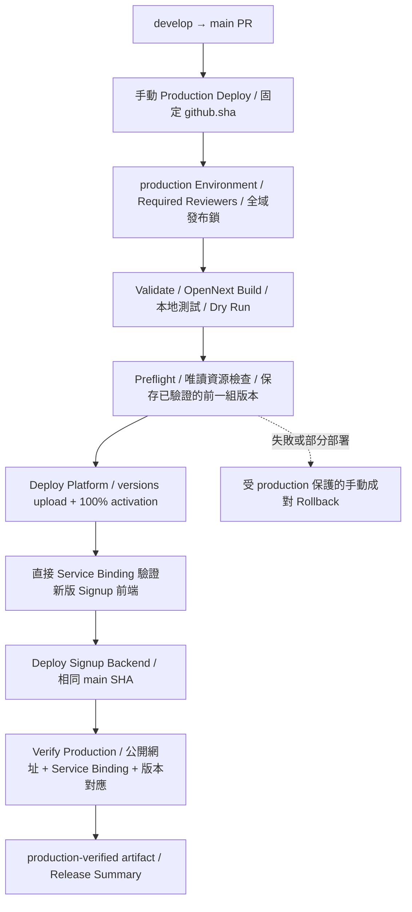
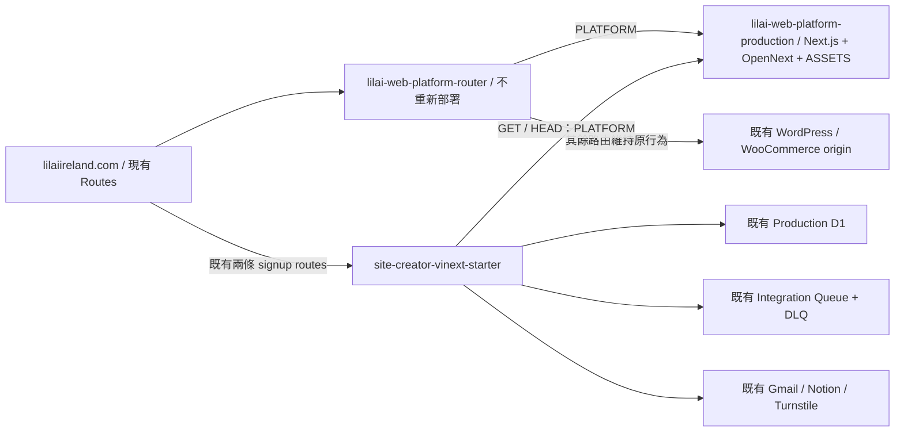

# Unified Production Release

本 PR 僅建立程式碼與 CI/CD。尚未觸發正式部署、修改 Routes、套用 D1 Migration、
送出正式申請、寄 Gmail、寫 Notion，亦未修改舊 Repository。

## 架構與版本契約





這是依序發布，Cloudflare 不提供兩個 Worker 的單一原子交易。每次發布前必須審核
相鄰版本間的 API、頁面資產及 Queue payload 相容性；`compatibility_approved`
預設為 false。兩個新版本的 message 均包含完整 main SHA、run ID、attempt，
驗證成功才寫入 `production-verified`。中途有錯即停止，不宣告成功，不自動回滾。

## 2026-11-23 唯讀架構審查

Source refs：main `e3c58f9217ab4216e1f1cbe9c9ac9d1030b6f852`；
develop `8c8b72ad2762d265badb9113c250989eee36f62b`。

| 項目 | 核對結果 |
| --- | --- |
| Account | `622900d9297cd7c09cad966aaae64617` |
| Zone | `2cabb0ba90198b8d4a88a58e5bc6c757` |
| Platform Version | `81dfa3b4-c739-4f1c-ae87-9d11c547dc2c` |
| Signup Backend Version | `02a78b7f-f5fc-4e9c-b006-bd09b66172fc` |
| Router Version | `88455f24-219b-4ecb-add5-17c5e029a92d` |
| 舊 Repo main | `8b47338f89834805d2197f1cf3607c49f10b6c71`，與線上部署 message 的 `8b47338` 相符 |
| Production D1 | `lilai-applications-production` / `d7b4209c-fce2-4f0d-9b18-3f19c183b430` |
| Integration Queue | `lilai-application-integrations` / `83621ba473bb43409984bd627e8c0453` |
| DLQ | `lilai-application-integrations-dlq` / `d15f435bf7c1472bad5446c836b74c88` |
| Queue Consumer | 原 Worker；batch 5、wait 5 秒、retries 5、retry delay 60 秒 |
| Cron | `*/10 * * * *` |
| Rate limiter | `APPLICATION_RATE_LIMITER` / namespace `76082801` / 30 次每 60 秒 |
| Secrets | 十個必要名稱皆存在；未讀取或輸出其值 |
| D1 Migration | 0001、0002 已套用；時間記於 baseline；新舊 Repo SQL 相同 |
| Backend Service Binding | **目前沒有 PLATFORM**；正式環境仍由舊 vinext Worker 提供 Signup |
| Router Service Binding | `PLATFORM → lilai-web-platform-production` |
| Public exposure | Platform / Router 關閉 workers.dev 與 previews；Signup 兩者皆已開啟 |
| Custom Domains | 這三個 Worker 皆無 Custom Domain |

完整固定值位於 `cloudflare/production-baseline.json`；Migration hash 使用 LF 正規化，
避免 Windows checkout 的 CRLF 與 Linux CI 不同。不能把本次 main SHA 當成既有
Platform 的已證實來源：首次快照的 `commit` 為 null，保留精確 Version ID 及
`legacyCommit`；之後由已驗證 artifact 傳遞正確的前次 commit。

Routes 保持：

- `lilaiireland.com/* → lilai-web-platform-router`
- `lilaiireland.com/language-school-signup → site-creator-vinext-starter`
- `lilaiireland.com/language-school-signup/* → site-creator-vinext-starter`
- `*.lilaiireland.com/* → 無 Worker`

舊 Repo 的 `wrangler.jsonc`、Worker 入口、package scripts 與 Migration 已讀取。
舊 Repo 沒有 `.github/workflows/`，Actions API 回傳 0 runs；package 提供
`deploy:vinext` CLI，線上部署來源為 Wrangler。未能只憑這些資料排除 Dashboard
Builds 或其他外部部署器；第一次切換前由維運人員確認並停止同時發布。
現行回滾以 Cloudflare 既有 Worker Version 為基礎，舊 Repo 無成對回滾 Workflow。

## Workflows 與 Preflight

`production-deploy.yml` 僅有 workflow_dispatch。只取 dispatch 的 main SHA，
單一 runner 建置一次並依序執行六個具名階段。main 在 Preflight 前移動會要求
重新觸發；Preflight 後即使 main 移動，兩個 Worker 仍使用原本 checkout 的 SHA。
非 main 的執行不會部署。`production-rollback.yml` 共用
`cloudflare-production-release` concurrency group，`cancel-in-progress: false`。

既有 `production-private-deploy.yml` 保留 PR/push 的純驗證；移除 Platform-only
部署 job 與 CLI，以免繞過發布鎖。原 staging Workflow 維持獨立。

Preflight 自動核對：

1. workflow_dispatch、main、checkout SHA、遠端 main SHA、固定 Cloudflare account。
2. GitHub Token 可讀 main、production Environment、main-only branch policy、
   Required Reviewers、Actions artifacts；權限明列 contents:read、actions:read。
3. Cloudflare API Token active、三個既有 Worker 及單一 100% active version。
4. D1 ID / 名稱、Migration history 與 SQL hashes，不允許新增或更動 Migration。
5. 十個 Secret 名稱、Queue Producer/Consumer/DLQ、Cron、rate limiter、Service Binding。
6. 整個 zone route table、Custom Domains、workers.dev / preview exposure 與 baseline。
7. 首次核對舊版 Version；一般發布核對最新成功 run 的 `production-verified` 版本組。
8. 部署前公開 GET/HEAD、SEO、靜態資產與空 JSON 拒絕測試，保存通過的回復點。

Build 與 Wrangler Dry Run 在 Validate，未通過無法進入 Preflight 或部署。
實際部署使用 `wrangler versions upload --keep-vars`，再以 Workers Deployments API
啟用單一版本。它不執行會重套 Routes、Queue Consumer、Cron 或 workers.dev 設定的
`wrangler deploy`；Router 完全不更新。Backend 明確 `--env production`，仍使用
`worker/signup/index.ts`。初次部署移除舊 vinext 的 ASSETS / IMAGES binding，
以 PLATFORM 提供 Next.js 頁面；原資料、Secrets 與 API 邏輯不變。

Signup 既有 workers.dev / previews 開啟狀態被明確記錄並持續檢查，不默默視為私有。
這是現有曝光的保留，不是本 PR 新增；若要停用，請另行審核並更新 baseline。

## 一般正式部署

1. 將 feature PR 合入 develop，完成 CI；再經 release PR 將 develop 合入 main。
2. Actions → **Production Deploy** → main → mode=`release`。
3. 審核相鄰版本相容性後勾選 compatibility，送出一次，通過 production reviewer。
4. 等待六階段通過。保存 Release Summary、`production-evidence`、
   `production-results`、`production-verified` artifacts。

不需操作舊 Repo、不需 Migration 或改 Routes。latest verified artifact 遺失、
過期、線上版本被其他部署器更動，流程會停止，必須重新審核基準，不能猜測版本。

## 第一次正式切換

1. Review 本 PR 與 baseline；確認舊 Repo 的 deployed Version 與實際部署器。
   安排發布窗口，暫停其他人工/自動發布；本 PR 不修改舊 Repo。
2. 確認仍是 baseline 的三個 Worker Version；有差異先重新唯讀盤點並提出 PR，
   不調整 Routes、不創新 Worker、不改 D1 ID。
3. 將 CI/CD 變更透過 develop → main release PR 合併。
4. 手動 **Production Deploy**，mode=`first-cutover`，完成相容性確認及 production 審核。
5. Preflight 先驗證舊站並保存 before.json；artifact 上傳完成才部署 Platform。
   透過本地僅 GET/HEAD 的 remote Service Binding harness 驗證新版 Signup，
   然後才部署整合 Backend，最後驗證公開路由與 Backend → Platform 呼叫。
6. 執行以下獨立人工正式驗收，簽核後才停止舊 Repo 的部署。未通過時用該 run 的
   `before` 成對回滾，保留舊 Worker 靜態資產版本。

首次人工驗收必須另有明確操作授權、指定負責人、時間窗口與測試申請標記：

- 桌面 1440px、手機 390px / 375px：Signup、表單、共用 Header/Footer、overflow、
  focus-visible、console / hydration、Turnstile widget / hostname、Canonical、跳轉。
- 一筆經同意的真實測試申請，記錄既有 ST 流水號延續、D1 / Queue / Gmail / Notion
  各步結果與 idempotency；由人工核對，不在 Smoke Test 自動送出。
- 等待 Cron retry / Queue 健康及 DLQ 核對，確認不重寄、無遺漏。不得清 Queue、
  刪申請、重設序號來消除驗收痕跡。
- Admin API 使用原可存取的 URL 與受控 Token 核對；不擴充公開 Admin Routes。
- WordPress / WooCommerce 的瀏覽、購物車與既有 session，避免實際下單或寄通知。

## Smoke Tests

部署後自動檢查首頁、Signup GET/HEAD、裸網址與 query 保留、Signup 引用的同站
靜態資產、Turnstile config 結構、Canonical/indexability、WordPress REST、cart、
checkout、robots、sitemap。WP/WooCommerce/SEO 的 status、最終路徑與 redirect chain
須與部署前一致。兩個 Worker 另透過 remote Service Binding GET/HEAD 檢查 Next Signup。
Cloudflare active Version 與本 run message / SHA 必須相符。

唯一自動 POST 為 `{}`，沒有 Turnstile token；既有程式於任何 D1/Queue 寫入與
外部驗證前回 403 / turnstile_failed，本地測試也證實不會寫資料。正式環境不得自動
送有效 token、測試申請、Gmail、Notion 或 Queue message。本次實作只跑 Mock Smoke，
未執行這些正式 Smoke；首次未能證實的項目仍是 release gate。

## Rollback

1. 查看失敗 run 的 Summary、before.json、platform.json / backend.json，確認目前
   部署到哪一步。不要重跑 failed release 來假設它能修復成對版本。
2. Actions → **Production Rollback** → main；source_run_id 填該失敗 run，
   target=`before`。要恢復另一個成功發布則填其 run ID、target=`verified`。
3. 人工確認舊程式仍相容於目前 D1、Queue payload、Secrets、以及切換期間兩個版本，
   勾選 compatibility，通過 production reviewer。
4. Workflow 驗證 artifact 來源、main / workflow 身分、資源/Schema 未漂移及兩個
   Version 均仍可讀，然後成對啟用。回舊 vinext 時先 Backend（含原資產），再 Platform；
   整合版則先 Platform 再 Backend。
5. 重新執行資源快照、成對 Version 核對與 Smoke；成功才保存新的 verified artifact。
   若其中一步失敗保留狀態，不宣告成功，維運人員依快照處理，不執行資料回復。

回滾不回復 D1 資料、Schema、已發出的 Queue Message、Gmail 或 Notion。
Artifact 保留 90 天，仍受 Repository 上限影響；Cloudflare 版本保留亦有限，
長期復原需另行保存證據與驗證目標版本可用性。不可假設永遠可回到舊版。
參考 [Cloudflare Rollbacks](https://developers.cloudflare.com/workers/versions-and-deployments/rollbacks/)。

## D1 Schema 變更的獨立程序

一般發布與 Rollback 都不執行 migrations apply / export / restore。若需要新增
Migration：另開 schema PR，審核 expand/contract 與前後 Worker 相容性，另行授權
正式備份並驗證備份可還原、記錄 Time Travel bookmark，再以額外人工核准程序套用。
套用後唯讀重審 history 與 SQL hash，PR 更新 baseline。未完成前發布會被阻擋。
禁止 drop/recreate、清空 D1、刪 Queue 或重設 ST 編號；備份含個資，不存一般 CI artifact。

## 本次驗證與尚需完成的前置條件

| 檢查 | 結果 |
| --- | --- |
| npm ci | 通過；未升級依賴 |
| 新增 CI/CD 本地測試 | 7/7 通過，含多種資源漂移、拒絕未授權 API mutation 與 probe 防寫入 |
| signup:test | 26/26 通過，含本地 D1 / Queue / Cron 與 Mock Gmail / Notion |
| Signup / App / Cloudflare TypeScript | 通過 |
| Shared layout / Design system | 通過 |
| Release strategy / Route safety / Routing / Router / Integration / SEO policy | 通過 |
| Production OpenNext Build / npm run build | 皆通過，含 /language-school-signup 與 Static Assets |
| Platform / Signup Wrangler Dry Run | 通過；另保留既有 Router Dry Run（未部署） |
| 唯讀 Production infrastructure Preflight | 通過：真實 Workers / Routes / D1 history / Queues / Cron / binding / Secret 名稱 |
| GitHub production Environment | 已有 reviewer tzuyuchang、main-only branch policy、CLOUDFLARE_API_TOKEN；account ID 為 Repo variable |
| GitHub Workflow YAML | YAML parse 通過；仍需 main 上的第一次實際 Actions 執行 |

部署使用的 Cloudflare Environment Token 不能從 GitHub 讀出，因此本次以已登入的
OAuth 完成唯讀盤點，未能證實該 CI Token 的完整實際權限。首次執行會驗證 Token
與讀權限；操作者需確認 Workers Scripts Edit、Account/Zone/Routes Read、D1 Read、
Queues Read，以及 remote-binding preview 所需權限。無需 DNS/Routes Edit、D1 Edit
或 Queue message write 來執行這套發布器；若 Cloudflare remote dev 要求額外權限，
應先在受控環境驗證，不繞過失敗檢查。

若維運人員要單獨重現唯讀基準檢查，可在已安全設定 `CLOUDFLARE_API_TOKEN` 的
shell 執行以下命令。它不包含公開 POST、版本上傳或啟用：

```sh
node --input-type=module -e "import {capture,assertInfrastructure} from './scripts/production/lib.mjs'; assertInfrastructure(await capture(),true); console.log('PASS legacy baseline');"
```

首次整合後把最後的 `true` 移除，改為檢查整合後的 binding 契約。

未完成：Actions 端到端執行、真實 Service Binding Smoke、公開正式 Smoke、受控
真實申請/Gmail/Notion 驗收、Rollback 演練、完整 CMS 靜態命名空間碰撞盤點。
Windows OpenNext 顯示相容性警告但本次建置成功；正式 CI 使用 Ubuntu。
既有 lint script 使用已移除的 next lint，未執行或修復。
npm ci 報告 26 項既有 vulnerabilities（13 moderate / 12 high / 1 critical），本次未做依賴清理。

## 舊 Repository 何時可停止部署及封存

必須先有首次切換的 verified artifact、人工完整驗收簽核、雙 Worker 版本對應、
Queue/Cron/Gmail/Notion 正常的觀察紀錄及可用的舊版復原證據。確認沒有 Dashboard
Builds、外部 CI、webhook 或人員仍從舊 Repo 發布，且後續一般發布只需本 Repo 一次
dispatch。之後才另行授權停用舊部署入口，保留原始碼與版本記錄。封存是獨立後續
操作；本 PR 不修改、刪除或封存 `language-school-signup-page`。

## 修改檔案

- `.github/workflows/production-deploy.yml`：統一手動發布。
- `.github/workflows/production-rollback.yml`：受保護的成對版本復原。
- `.github/workflows/production-private-deploy.yml`：只保留自動驗證，加入新測試。
- `scripts/production/lib.mjs`：固定資源、來源、設定與漂移檢查、去除值的快照。
- `scripts/production/release.mjs`：Preflight、版本發布、驗證、artifacts、rollback、summary。
- `scripts/production/smoke.mjs`：安全公開 Smoke 與本地 remote-binding harness。
- `cloudflare/production-release-probe.{js,jsonc}`：僅本地 GET/HEAD binding probe。
- `cloudflare/production-baseline.json`：真實資源、舊版 Version、Migration 基準。
- `tests/production/release.test.mjs`：本地 / Mock 保護性回歸測試。
- `scripts/check-production-{packaging,release-strategy,route-safety}.ts`：發布政策及 Dry Run 更新。
- `scripts/cloudflare-production.ts`、`scripts/production-route-safety.ts`、`package.json`：移除單獨正式發布入口。
- 本文件與 `docs/production-route-safety.md`：新版部署、首次切換、復原與限制。
- `README.md`：現行正式部署手冊入口。

本次需求來自使用者的 Production CI/CD 規格，未提供對應 Issue 編號。
